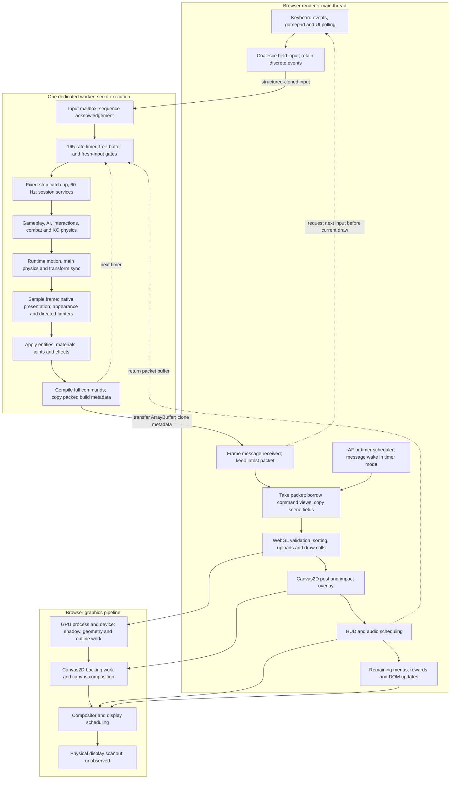
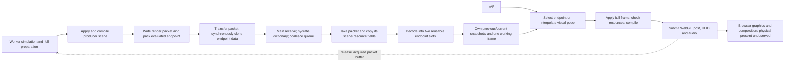

# Frame pipeline and measurement gaps

Repository inspection: October 9, 2026. This document owns the pipeline map and
the first instrumentation milestone. The [audit](touch-of-death-performance-audit.md)
owns measured conclusions; the [experiment plan](touch-of-death-165-plan.md) owns
the remaining program. Verdict: **165 Hz fresh-motion gameplay is unproven**.

Inspection hashes are in `.local/engine-perf/pipeline-20261009/inspection.json`.
Of the prior campaign's 675 frozen modules, one generated mailbox bundle differs
on current disk. New measurements must freeze their complete source/build graph;
the old executable remains the historical control.

## Two actual execution paths

[Ordinary standalone play](../../../../../apps/engine-editor/src/standalone-3d.ts)
polls input, advances fixed simulation, prepares presentation, compiles independent
camera/light views and submits rendering on the main thread. The
[opt-in entry](../../../../../apps/engine-editor/src/standalone/entry-world.ts)
adds a persistent owner; most recent full-loop experiments use its worker mode.
The following diagram describes the original measured worker path, not the
ordinary default. The private display experiment below has a different schedule.

Arrows express dependencies, not measured non-overlapping durations. Browser
graphics task placement and the mapping to display frames are not reconstructed
from current records. The diagram's simulation sequence has branches: hit stop,
menu/countdown, KO and recovery can skip ordinary physics or advance other state.

### Private display path — October 10 update

The [integrated display experiment](history/performance/october-10-compact-publication.md)
keeps authored fixed simulation at 60 Hz, requests a nominal 60 Hz producer and
samples presentation from rAF with a separately configured delay. It remains a
private experiment; the preceding diagram still describes the original host.

Worker production overlaps main preparation/submission and browser GPU work.
Each display sample's interpolation, application, compilation and submission are
serial main-thread dependencies. A display can repeat/interpolate without a new
publication; no simulation tick is created. Packet resource copies can overwrite
the consumer scene before application, so input identity cannot replace live
resource checks. The packed endpoint buffer is borrowed until synchronous message
cloning returns; decoded endpoints are borrowed until two subsequent decodes.

Current critical-path measurements belong in the [audit](touch-of-death-performance-audit.md#ranked-bottlenecks).
The original stage table below is historical attribution, not this variant's
budget. Its production, display and GPU paths must each meet their cadence and
freshness requirements; adding their durations would double-count overlap.

### Simulation order and state publication

[The mailbox](../../../src/experimental/simulation/mailbox.ts) consumes ordered
events and the latest continuous input at 16.667 ms steps, allowing at most 250 ms
catch-up. [Session services](../../../../../apps/engine-editor/src/standalone/world/session.ts)
wrap each step with replay recording and learning. [Gameplay](../../../src/project/3d/gameplay.ts)
applies behavior commands, runs combat, then advances the runtime unless frozen.
[Combat](../../../src/project/3d/combat-gameplay.ts) handles environment updates,
surface queries, AI/navigation, interactions and strikes, motion/impulses and its
separate KO world. [Runtime advance](../../../src/project/runtime-3d.ts) updates
controllers/platforms/animation, steps the main physics world and copies body
positions into transforms. These owners execute serially on the same worker.

There is no independent simulation publisher in this path.
[Worker production](../../../../../apps/engine-editor/src/standalone/world/worker.ts)
calls `world.render()` only with a free packet buffer and, in fresh-input mode,
an input response. Simulation advances inside that call. Buffer backpressure or
an input-handshake delay therefore also delays simulation; the next call catches up.
`runtime.tick`, combat frame and session step count are different counters, especially
during hit stop and interludes. None alone identifies a distinct state or pose.

### Ownership, copies, queues and lifetimes

| Boundary | Current contract |
| --- | --- |
| Input | One unacknowledged host message; held input coalesces, discrete events are bounded to 64 on each side. Sequence and applied sequence are distinct. |
| Worker state | Own runtime, simulation, physics, evaluated frames and presentation history. Initialization clones project/assets/checkpoint into the worker; the host retains its own runtime/scene. |
| Render packets | One to three fixed-capacity transferable buffers. A depot control uses 725,316 bytes per packet, two buffers totaling 1,450,632 bytes. Full fixed-capacity numeric fields are copied when packing, not only changed records. |
| Publication | `postMessage` transfers packet ownership and clones HUD/effects/audio/camera metadata. No shared-memory atomics or independent simulation stream. |
| Host queue | One latest packet slot. Superseded packets are returned; their audio is retained separately, bounded to 256 events. A taken packet is borrowed until synchronous drawing returns. |
| Decode | Command typed arrays borrow packet storage. Material flags/data/texture handles and skeleton matrices copy into the host scene. Returned buffers cannot back retained commands. |
| Commands | Host requests and controller commands each have a bound of 32. Mutation boundaries serialize; revision rejects obsolete packets and rebases input. Worker transport epoch is currently initialized to 1. |
| Storage | Learning storage crosses to the host; at most eight service requests with timeout. Save/restore and graceful shutdown have explicit request boundaries. |
| GPU resources | Host renderer owns programs, VAOs, buffers, mesh/texture caches and a 2048² directional shadow map. Mesh/texture upload is lazy; replacement/deletion/context restoration invalidates resources. Packet return does not await GPU completion. |
| Lifecycle | Focus loss, hiding and graphics loss suspend the owner. Context recovery rebuilds renderer resources. Watchdog distinguishes packet exhaustion from a stalled producer; close flushes services, dispose terminates ownership. |

Owners: [host](../../../../../apps/engine-editor/src/standalone/world/host.ts),
[controller](../../../../../apps/engine-editor/src/standalone/world/controller.ts),
[packet layout](../../../src/experimental/frame-packet-3d.ts),
[renderer](../../../src/render/3d-webgl2.ts).
The fixed packet does not transport mesh or texture payload updates or a versioned
scene registry. That is a limit of this experiment's fixed-content contract.
Worker mode also locks several main-world launchers, including wardrobe, network
and replay modes; full local services do not mean every ordinary playable mode works.

## Presentation writers and invalidation obligations

The pipeline composes mutable evaluated records from several owners. A future
version protocol must cover both these writers and external public API mutation.
The table is an inspection inventory, not a proved invalidation implementation.

| Owner / writer | Inputs and output that must invalidate |
| --- | --- |
| Runtime commands and both physics worlds | Teleport, rotation/pose, velocity/impulses, collision response, platforms, layout/spawn changes; transforms and bounds. |
| [Frame sampler](../../../src/frame/3d.ts) | Tick/time, simulation poses, timeline tracks, physical performance, seed and viewport; entities, materials, camera, effects, rig performance and render graph. |
| [Combat presenter](../../../src/project/3d/combat-presentation.ts) | Combat/motion/events, defense and locomotion cues, interaction state, match/recovery, KO bodies, environment/traffic/hazards; poses, visibility, materials and effects. |
| Camera and obstructions | Fighter targets, camera/aspect, static and moving occluders, weapon placement, hierarchy/bounds and material mappings. Camera orbit and cutaway fades also retain history. |
| Appearance and [directed fighters](../src/presentation/art-direction/integration/runtime.ts) | Equipped looks, styles/poses, health/actions, velocity/grounding, weapon state, reduced motion; limb/wardrobe transforms, expressions and particles. Locomotion, action transitions, prior health/yaw and particle emitters retain history. |
| [Frame application](../../../src/project/runtime-3d.ts) | Entity transforms/visibility/mesh/material selection, skeleton clips/blends, corrections/IK, physical presentation, particles and lights. Existing transform dirty tracking and value caches still check live destination storage. |
| [Texture replacement](../../../src/project/3d/runtime/textures.ts) and host uploads | Loaded/replaced/reset pixels, material texture bindings and revoked uploads. These may change without a simulation step. |
| Host presentation | Viewport/DPR, shadow settings, reduced motion, photo camera/removal, pause/review/UI, screen effects, HUD and impact overlays. Audio changes independently and must not increment a visual-pose counter. |
| Restore/reset/review/rollback | Portable load, world commands, round reset/recovery, replay seek/takeover and checkpoint restore can change state at the same tick. Restore is a discontinuity even when tick and object identity match. |
| Public scene mutation | Register/destroy/reuse instances, meshes, lights, textures, materials, transforms and skeletons, plus exposed typed-array edits. No single mutation epoch currently covers these. |

Important history gap: directed presentation resets on backward combat-frame
movement or a large teleport; it has no explicit owner-epoch reset. Portable
combat restore resets camera/fade history, while trusted checkpoint restore takes
a different path. Same-tick restore and small-teleport history equivalence need
tests before caching or interpolation. Inspection alone does not establish a
visible defect. A borrowed frame's identity is never a valid dirty signal.

## Critical path and provisional budget

Within a producer request, fixed steps, preparation, application, compilation and
packing are serial. Host receive/decode/draw follow publication of that request.
The next worker request can overlap drawing the prior packet because fresh input
can be posted before drawing. GPU work can overlap both CPU realms. Input handshakes,
buffer availability, command boundaries, main-thread scheduling and browser graphics
dependencies can remove that overlap. Queue waits add pose/input age even when they
do not consume CPU. Canvas2D copies depend on the rendered canvas; their synchronization
cost is not covered by the WebGL timer.

Historical observations below are separate probes from the
[October 9 history](history/performance/october-9-ceiling-spikes.md), not a new
aligned trace or an additive budget. Targets are provisional investigation limits,
not achieved timings or permission to alter latency/gameplay.

| Region | Existing observation | Budget/evidence required |
| --- | --- | --- |
| Complete worker request | About 12.9 ms diagnostic mean in depot/roof | Current display-rate producer needs about 5 ms p95, with deadline/tail evidence. A different producer rate needs a separately measured freshness budget. |
| Frozen preparation | 6.20 / 5.70 ms median; includes application | Profile call counts and self/total time; existing work alone consumes almost the 6.06 ms visual interval. No reliable fresh-work substage allocation yet. |
| Static view compile | 0.30 / 0.40 ms median | Measure advancing, full-stream and independent-view compilation separately. |
| Packet write/read | About 0.013 / 0.006 ms in frozen depot | Preserve bytes/ownership evidence; measure metadata clone and actual send/receive separately. |
| Main-thread work | About 5.68 / 7.36 ms diagnostic mean | About 5 ms p95 for the complete visual update, not merely the WebGL call. |
| WebGL GPU work | About 6.05 / 7.87 ms diagnostic mean | About 5 ms p95 investigation target; per-pass coverage and invalid-query counts required. Excludes post/compositor. |
| Post, compositor, delivery and scheduling | No complete per-frame attribution; long gaps remain | Account for each independently and map submissions to browser presentation observations. |
| Visible update | 6.0606 ms at 165 Hz | Report deadline misses, p99.9, repeat runs and pose/input age; average throughput cannot pass this gate. |

Do not sum this table. Even stage labels currently differ: the ceiling probe's
`prepare` includes application, while worker `presentationMs` excludes application;
worker `compileMs` includes application, packet writing and view-matrix construction.
The worker's `computeMs` ends before output metadata construction/audio draining
and structured cloning. Main `mainMs` can exclude input polled before the wake.
These boundaries need normalization before another optimization comparison.

## Instrumentation inventory

| Measurement | Present | Missing or misleading |
| --- | --- | --- |
| Frame/input identity | Producer frame, input/applied sequences, runtime tick, service ticks, command revision | Distinct state version, pose version, discontinuity/resource epoch, host submission ID and browser-frame mapping. Packet schema version/signature identifies layout, not content. |
| Clocks | Host/worker use `performance.timeOrigin + performance.now()` and a shared start origin | Clock-origin/precision receipt and bounded cross-realm validation; complete per-stage absolute endpoints. |
| Publication/transport | Worker ready time, host receipt/take, acknowledgement times | Distinct publish/send-call boundaries, clone cost, buffer-wait and fresh-input-wait intervals. |
| CPU timing | Local wall durations, optional nested presentation stages, profiles | Per-tick AI/main-physics/KO spans, unmeasured metadata work, call counts/self time and trace CPU residency. Wall duration is not executed CPU time. |
| Render endpoint | `markSubmitted()` plus draw/post/HUD duration | **The mark occurs before drawing. Existing input-to-submit numbers end at render start.** Add start and end, then browser presentation observation separately. |
| GPU timing | Async whole-WebGL query, maximum eight pending | Per-pass queries; explicit disjoint, unsupported, queue-full, lost-context and unresolved status/counts. Post/compositor are outside its scope. |
| Traces | Browser trace plus main/worker CPU profiles; marked measurement windows | Default categories do not ensure compositor/GPU coverage. Validate process/thread coverage and complete export; match app IDs to trace events. |
| Statistics | p50/p95/p99/max, phase slices, threshold counts, repeated-control spread | p99.9 with sufficient samples, consecutive pose repeats, pose-age distributions, paired session uncertainty intervals. Current bounded retention cannot describe a long soak by itself. |
| Input response | Browser key event to applied-sequence render-start probe | A consumed input need not visibly change anything. Need a known gameplay response, pose-change oracle and first corresponding browser-present observation; physical input-to-photon remains unobserved. |
| Environment | Before/after power, GPU temperature/clocks/utilization/memory; CPU/memory profiles | Continuous bounded observations, other-process activity, CPU temperature when available, shader/resource events and retained-working-set trend. Missing CPU temperature stays unknown. |

Sources: [telemetry](../../../../../apps/engine-editor/src/scene3d/performance/telemetry.ts),
[GPU timer](../../../../performance/browser-gpu-timer.ts),
[input probe](../../../../../spikes/persistent-world-worker/input-latency.ts),
[trace owner](../../../../../spikes/persistent-world-worker/diagnostics/profile.ts).
rAF timestamps indicate callback scheduling; none of these tools currently proves
physical scanout. Missing presentation observations must remain missing, not be
filled with rAF or render-end time.

The renderer path inspected has no explicit temporal-AA accumulator, jitter or
motion-vector pass. Standalone creation leaves WebGL AA attributes to the context
defaults. That narrows investigation but does not explain the observed normal-AA
variation. Record actual attributes/sample count, resource/context identity, exact
draw order and controlled initial histories. Keep AA-off diagnosis separate from
production-AA acceptance; earlier failed candidates remain failed.

## First milestone: trustworthy frame provenance

The [first instrumented cohort](history/performance/october-9-frame-provenance.md)
implements schema-2 CPU endpoints, clock bounds, separate producer/host pose
comparison, bounded trace marks, GPU validity and strict browser-frame association.
The [follow-up](history/performance/october-9-cadence-and-controls.md) validates
pose identities against an independent oracle, checks ending clock bounds and
separates browser pacing from engine work. October 10 controls recovered about
165 empty-page callbacks/s; the earlier fallback's cause and recovery remain
unexplained (see the audit's system-counter evidence).
The inventory above describes the original baseline; the linked receipt owns
implemented measurements and remaining acceptance. Historical render-start
latencies remain schema 1. Browser feedback does not establish game pixel contents
or physical display presentation. The complete milestone below remains open.

Extend the existing host/worker/telemetry and campaign owners. Change measurement
only, retain the current scheduler and packet behavior, and version the exported
schema so historical render-start values cannot be mistaken for a corrected endpoint.
No final library layout or worker topology is selected yet.

1. Add bounded records joining session/owner epoch, request, input/applied sequence,
   fixed-step sequence, runtime tick, combat frame, state/pose identity and submission.
   Define pose content independently from audio/HUD metadata; check identity against
   a full canonical pose comparison in a separate diagnostic lane. Measure the cost
   of change detection rather than hiding it in the benchmark.
2. Timestamp input event/poll/send/receive, step and preparation boundaries, packet
   publish/send/receive/take, draw start/end and complete main update. Mark queue
   waits explicitly. Record clock origins, timer precision and alignment uncertainty.
3. Add bounded correlated trace marks and explicit GPU-query status. Retain an
   honest observation kind: callback, CPU submission, browser-present trace event
   or unavailable. No software endpoint is named physical display presentation.
4. Extend reports with p99.9/sample counts, deadline misses, consecutive repeats,
   pose age and event-to-visible-response evidence. Export bounded chunks for long
   runs; pair complete sessions for uncertainty rather than treating adjacent frames
   as independent trials.

Acceptance: fake-clock/event-order tests; same-tick restore/epoch separation;
input coalescing and discrete-event preservation; repeated versus changed poses;
missing-query/presentation handling; bounded records and packet lifetimes; unchanged
state/packet and normal-AA controls in depot/roof; separately measured instrumentation
overhead and retained memory. Unstable controls make overhead inconclusive too.
Readbacks/full hashes belong to separate correctness diagnostics, never throughput.

After this milestone, run baseline controls across multiple warmed sessions and
explain drift before dirty preparation, render experiments or motion architectures.
Existing latency policy forbids material regression but has no verified absolute
input-to-visible threshold; do not silently allow an extra interpolation tick.
